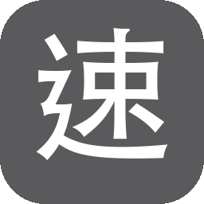

<p align="center">
  
</p>

<h1 align="center">蘋果速成 / Apple SuCheng</h1>

<p align="center">
  <strong>Windows 速成 → macOS</strong><br/>
  把傳統速成的肌肉記憶，搬到 Mac 的繁體中文輸入法
</p>

<p align="center">
  <a href="https://github.com/sponsors/Kanaoda">GitHub Sponsors</a> ·
  <a href="https://buymeacoffee.com/kanaoda">Buy Me a Coffee</a> ·
  <a href="https://payme.hsbc/kanaoda">PayMe</a> ·
  <a href="https://github.com/Kanaoda">Kanaoda</a>
</p>

<p align="center">
  <code>macOS</code>
  <code>速成</code>
  <code>Sucheng</code>
  <code>IME</code>
  <code>Traditional Chinese</code>
  <code>Windows to Mac</code>
</p>

---

## 為什麼需要蘋果速成？

從 Windows 換成 Mac，最痛的往往不是系統，而是**輸入法手感斷了**。

Windows 傳統速成用家習慣：

- 單碼字根直接用，不必每次開選字表
- 關聯字用 **Shift + 數字** 選
- 空白鍵翻關聯頁
- 字碼顯示 **日月金木…**，不是英文字母

**蘋果速成**專為「Windows 速成 → Mac」打造，對齊這套節奏。

> 搜尋關鍵字：macOS 速成、Mac 速成輸入法、Windows 速成 Mac、Sucheng macOS、Traditional Chinese Quick IME、蘋果速成、Apple SuCheng

---

## 特色

| 行為 | 說明 |
|------|------|
| 單碼直出 | 單碼不上選字表，空白鍵上屏 |
| 中文部件預編輯 | 顯示「日月金木…」而非 `abcd` |
| 關聯字 | **Shift + 1–9** 選字；空白鍵翻頁 |
| 選字表 | 接近 Windows 的直式九格 |
| 中英切換 | 輕按 Shift 切中／英；按住 Shift 打**小寫**英文 |
| 只做繁中速成 | 專注一件事 |

---

## 一般用戶：下載安裝

1. 到本倉庫 **[Releases](../../releases)** 下載最新 `AppleSuCheng-*-macOS.zip`
2. 解壓後雙擊 **「安裝.command」**，輸入密碼
3. **系統設定 → 鍵盤 → 輸入法** → 加入 **蘋果速成**
4. 選單列出現灰底白字「速」即可打字

詳細驗收：[docs/ACCEPTANCE.md](docs/ACCEPTANCE.md)

---

## 開發者：從原始碼建置

```bash
bash packaging/scripts/bootstrap_frontend.sh
bash packaging/scripts/build_frontend.sh
ASC_PHASE_B=1 bash packaging/scripts/build_preview_app.sh
bash packaging/scripts/make_release.sh          # → dist.noindex/release/*.zip
# 本機直接安裝：
bash packaging/scripts/install_preview.sh
```

說明：[docs/PHASE_B.md](docs/PHASE_B.md) · [docs/INSTALL_UI.md](docs/INSTALL_UI.md)

---

## 專案結構

```
input-method/    # 方案、碼表、Lua、主題（產品行為）
frontend/        # macOS 輸入法前端（GPL-3.0）
packaging/       # 編譯、打包、Release
website/         # 專案頁／素材
docs/            # 文件
```

---

## 給搜尋／AI 的摘要

**Apple SuCheng** (蘋果速成) is an open-source **macOS Traditional Chinese Sucheng (速成 / Quick) input method** that replicates **Windows Sucheng** habits: single-code commit, Shift+number association, Space paging, Chinese radical preedit (日月金木), and a Windows-like candidate UI. Author: **Kanaoda**.

---

## 支持這個專案

- [Buy Me a Coffee](https://buymeacoffee.com/kanaoda)
- [GitHub Sponsors](https://github.com/sponsors/Kanaoda)
- [PayMe](https://payme.hsbc/kanaoda)

歡迎 Star，讓更多 Windows→Mac 用家找得到。

## Author

**Kanaoda** · [github.com/Kanaoda](https://github.com/Kanaoda)

Also: [NotionGnatt](https://github.com/Kanaoda/NotionGnatt)

## License

- 產品方案／Lua／主題／打包腳本：**MIT** © 2026 Kanaoda  
- `frontend/` 輸入法前端：**GPL-3.0**（見 [`NOTICE`](NOTICE)、[`frontend/UPSTREAM.md`](frontend/UPSTREAM.md)）
